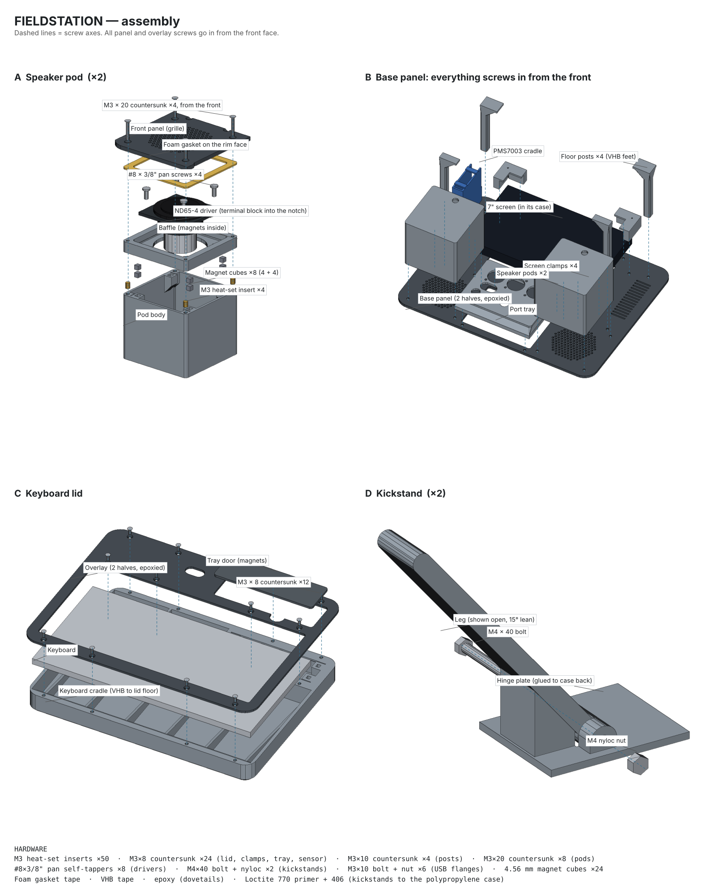
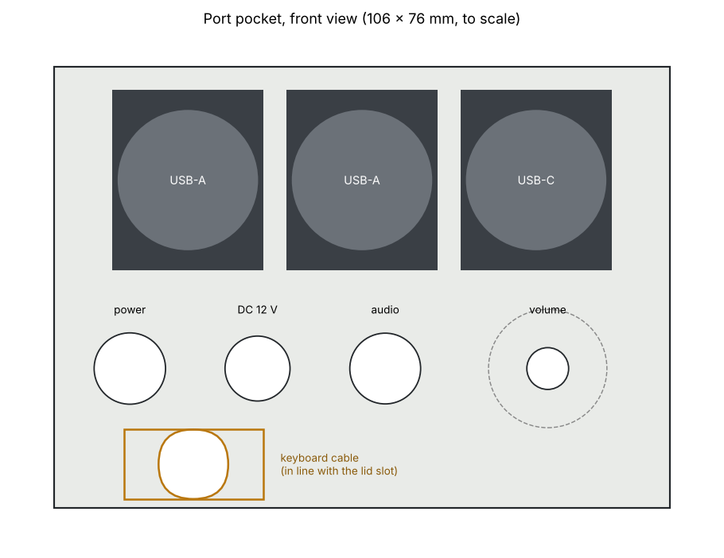
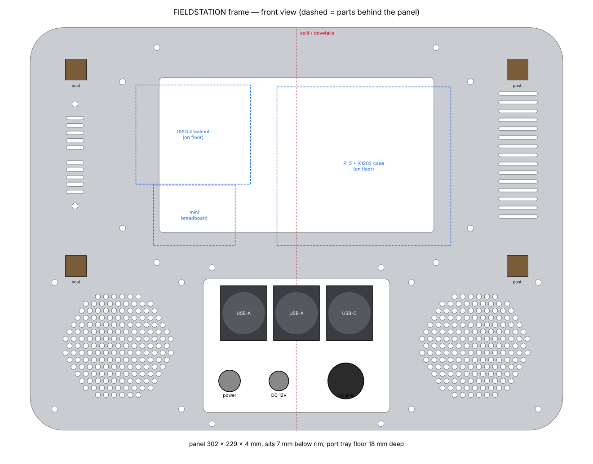
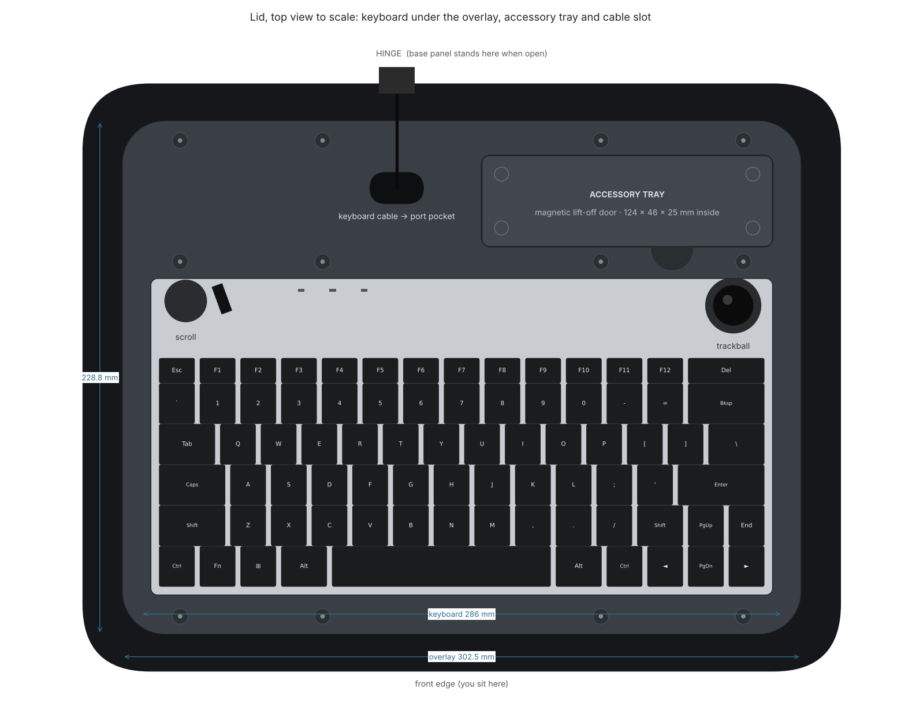

# FieldStation hardware

The 3D-printed enclosure for the FieldStation cyber deck: a Peli 1400 case standing upright, with the screen, speakers, sensors and ports on a front panel in the base, and a levelled keyboard under a matching overlay in the lid.



Where each part goes: [docs/placement_sheet.png](docs/placement_sheet.png). What sits behind the base panel, layer by layer, with the proposed KVM spot: [docs/internal_layout.png](docs/internal_layout.png)

## Layout

- **Base panel** (302.5 × 228.8 × 4 mm, sits 8 mm below the rim): 7" Waveshare HDMI LCD (H) in its case behind a 156 × 88 mm window; TEMP column on the left (the screen's HDMI and micro-USB plugs come out of its left edge into the space behind it); AIR column (Plantower PMS7003 behind louvres) on the right; two Dayton ND65-4 speaker pods along the bottom with a recessed port pocket between them.
- **Port pocket** (106 × 76 mm, floor 18 mm deep so nothing touches the keyboard): 2 × USB-A and 1 × USB-C D-size sockets on top; power button, 12 V DC jack, audio button and volume pot below; a 24 × 12 mm slot at the very bottom for the keyboard cable, in line with the lid's cable slot.
- **Behind the panel:** Pi 5 in a Geekworm X1202-C1 case (UPS, 4 × 18650) on the case floor behind the screen, with the GPIO breakout and mini breadboard beside it.
- **Lid:** wedge cradle that levels the trackball keyboard (286 × 149 mm), a 2.8 mm overlay that finishes flush with the keys, a USB-A pass-through for the keyboard cable, and a magnetic accessory tray along the hinge.
- **Back of the case:** two folding kickstands that stop at a 15° lean.

  

## Print files (`print/`)

Bambu Studio 3MF plates for a Bambu Lab P1S (256 mm bed). Every part is already in print orientation and none need supports.

| Plate | Parts |
|---|---|
| K1 | Keyboard cradle, left half |
| K2 | Keyboard cradle, right half, with the tray's magnet blocks |
| K3 | Lid overlay, left half (prints face down) |
| K4 | Lid overlay, right half, plus the tray door |
| B1 | Base panel left half, both speaker baffles, seam splice strip |
| B2 | Base panel right half, both speaker pod bodies |
| B3 | Port tray, four floor posts, four screen clamps, PMS7003 cradle |
| B3a | Port tray and PMS7003 cradle (the same parts as on B3, for printing them first) |
| B4 | Two kickstand hinge plates and legs |
| B5 | Floor plate: Pi case pocket, insert bosses for the perfboard and the GPIO breakout |
| speaker_pods_complete_x2 | Both complete pods (bodies and baffles) on one plate, if you print the pods separately from B1/B2 |

The KVM remote button lives in the lid's magnetic tray; its cable runs through the keyboard cable slots. The PMS7003 cradle on B3/B3a is printed mirrored so its board side faces the screen.

**Settings:** PETG, 0.2 mm layers, 4 walls, textured PEI plate. Use a brim on B3 (the posts are 87 mm tall). The whole set uses about 850–900 g.

## Hardware

| Item | Qty | Used for |
|---|---|---|
| M3 heat-set insert (M3 × 5.7, for a 4.0 mm hole) | 47 (+ spares) | Pods 8, screen clamps 8, port tray 4, posts 4, PMS7003 cradle 3, keyboard cradle 12, floor plate 8 (perfboard, breakout) |
| M3 × 8 countersunk | 24 | Lid overlay, screen clamps, port tray, sensor cradle |
| M3 × 10 countersunk | 4 | Floor posts |
| M3 × 20 countersunk | 8 | Speaker pods through the panel |
| #8 × 3/8" (ST4.2 × 9.5) pan self-tapper | 8 | Drivers to baffles (or M4 × 12 bolt + nyloc) |
| M3 × 10 bolt + nut | 6 | D-size USB socket flanges |
| M4 × 40 bolt + nyloc nut | 2 | Kickstand pivots |
| 4.56 mm magnet cube | 24 | Pod baffles 16, tray door 8 |
| Small cable tie (PMS7003 cradle), foam gasket tape, VHB tape, epoxy, polyfill | – | Pod and sensor seals, post feet and lid cradle, dovetail joins, pod damping |
| Loctite 770 primer + 406 (or 3M Primer 94 + VHB) | – | Kickstands to the polypropylene case |

## Assembly notes

1. **Inserts first.** Fit every heat-set insert into the bare prints, before any magnets or glue. Use about 225 °C for PETG and stop flush.
2. **Magnets.** Glue the cubes into the baffles and the tray door first. Stack each partner cube on top to get the polarity right, glue it into its pocket, then pull the stacked cube off. Let them cure before a driver comes near.
3. **Speaker pods.** Fit the driver from the front, with its terminal block in the baffle's single notch, on the same side as the cable hole. Seal the ends of the notch and the cable hole. The four M3 × 20 screws through the panel clamp the panel, baffle and body together; a foam gasket on the rim seals against the panel.
4. **Panels.** Dry-fit the dovetails, then epoxy the halves face down on a flat surface. Glue the splice strip behind the base-panel seam above the window.
5. **Lid.** The cradle halves can be dry-fitted. Screw the overlay onto the cradle, drop the assembly into the lid so the overlay centres it, then fix it with VHB (or Dual Lock if you want it removable). The roughly 6 mm gap around the cradle is intentional; it clears the lid's tapered walls and curved floor edge.
6. **PMS7003 sensor.** Fit the adapter board and Dupont plugs first. The cradle is built for the board lying on the label face (3.5 mm above it), overhanging the inlet face by 6.5 mm and the board end by 9 mm, with the plugs mid-thickness in front of the inlet face, pointing at the panel. The front of the cradle has two chambers split by a rib: the outlet chamber, and an inlet chamber that also holds the plugs. Drop the sensor in from the back, face first, with the board on the side where the sleeve wall is open, feeding the wires out through the slot in the inlet chamber's end wall. Hold it in with a cable tie round the sleeve and over the sensor's back, between the guide ridges. Then seal it so it only breathes through the louvres: foam gasket round the lip, and foam or putty in the wire slot and the small notch where the header pins pass. See [docs/pms7003_cradle.png](docs/pms7003_cradle.png).
7. **Kickstands.** Glue the hinge plates to flat areas about 100 mm up the back of the case.

## Source (`src/`)

The parts are built in Python with `manifold3d` and `trimesh`. Every dimension lives in the scripts, so changes go in there and the plates are rebuilt rather than edited by hand.

```sh
cd hardware/src
pip install -r requirements.txt
python build_all.py      # rebuilds every plate in ../print
python check.py          # collision check of everything behind the base panel
python assembly_sheet.py # redraws ../docs/assembly_sheet.png
python placement_sheet.py # redraws ../docs/placement_sheet.png
```

| File | Builds |
|---|---|
| `frame.py` | Base panel, port tray, floor posts, and the shared layout dimensions |
| `lid.py` | Keyboard cradle, lid overlay, tray door |
| `pod.py` | Speaker pod body and baffle |
| `screen_clamp.py` | Screen corner clamps |
| `pms7003_v2.py` | Ducted PMS7003 cradle |
| `kickstand.py` | Kickstand hinge plate and leg |
| `floorplate.py` | Floor plate glued to the case floor: Pi case pocket, perfboard and breakout bosses |
| `placement_sheet.py`, `assembly_sheet.py`, `pms_diagram.py`, `layout_sheet.py` | The placement, exploded-assembly, sensor-cradle and internal-layout drawings in `docs/` |

The case interior dimensions come from measurements of the real Peli 1400: 99 mm rim to floor, a 30 mm lid, and about 306.5 × 232.9 mm inside at the rim.

## Still to do

- KVM (StarTech C2-H46-UAC-CBL-KVM): mount behind the left half of the screen (see docs/internal_layout.png); needs a photo of the screen case's back. Needs right-angle HDMI and USB-A plugs on its console side.
- Confirm the D-size USB socket screw spacing (19 × 24 mm assumed) before printing the port tray.
